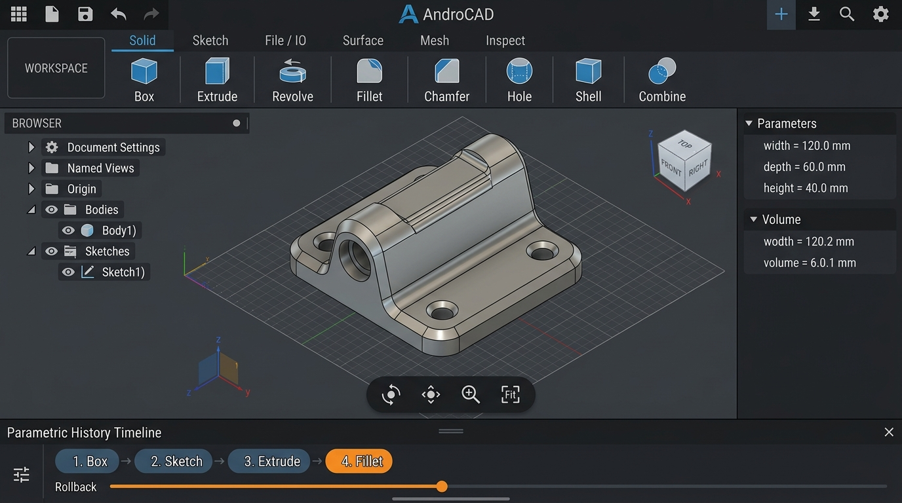
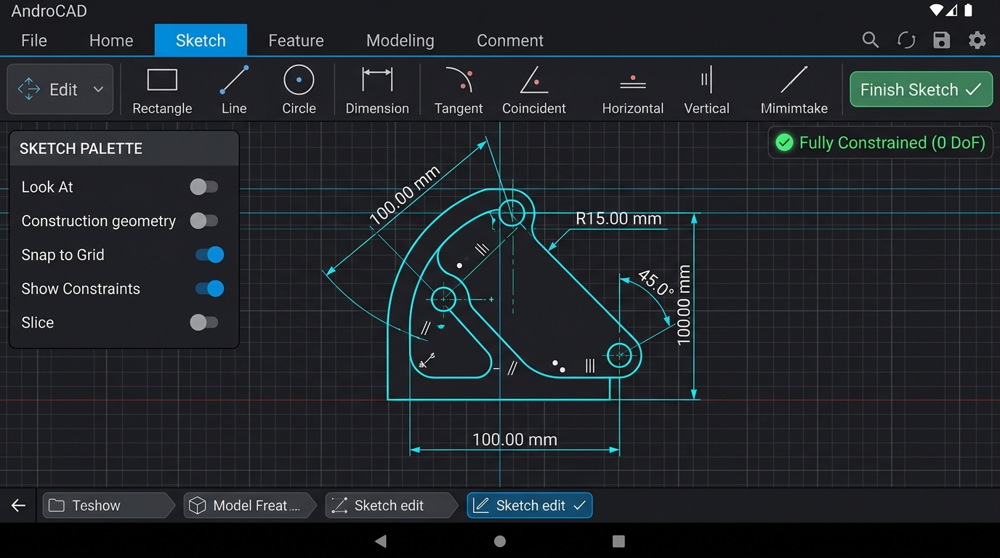

# AndroCAD

An original parametric 3D CAD application engineered for Android tablets and phones, powered by Open CASCADE Technology (OCCT 7.8.0) and the PlaneGCS constraint solver.

---

## Tablet UI & Workflow (Screenshots)

AndroCAD is built with a **tablet-first** engineering workflow following modern desktop CAD conventions:

### 3D Parametric Modeling & Viewport

*High-precision 3D viewport on an 11-inch tablet: Top workspace ribbon (Solid, Sketch, File/IO), left Browser tree with body visibility toggles, interactive 3D ViewCube, bottom-center navigation bar (Orbit/Pan/Fit/Display Modes), parametric Timeline with rollback marker, and right Properties & Parameters inspector.*

### 2D Parametric Sketcher with PlaneGCS

*2D Sketching mode with PlaneGCS geometric constraint solving: metric grid snapping, active dimensional and geometric constraints (tangent, coincident, horizontal/vertical), 'Fully Constrained (0 DoF)' status indicator, and instant 'Finish Sketch ✓' loop generation.*

---

## Key Features & Architecture

* **Geometry Kernel:** Open CASCADE Technology (OCCT 7.8.0), modularized and cross-compiled for Android `arm64-v8a` and `x86_64` using Android NDK r26d.
* **Sketch Constraint Solver:** PlaneGCS (Levenberg-Marquardt / Dogleg non-linear solver) dynamically linked for full 2D geometric and dimensional constraint solving.
* **Parametric DAG Timeline:** Transactional recomputation engine with rollback markers, named user parameters (`width * 2`), and deterministic topological reconstruction.
* **Persistent Naming (TNP):** 3-tier topological naming resolution (semantic tags -> `BRepTools_History` tracking -> invariant geometric fingerprints) preventing broken downstream fillets and sketches.
* **Rendering Architecture:** Native C++ OpenGL ES 3.x zero-copy pipeline streaming `BRepMesh` boundary tessellation and sharp edge primitives directly to GPU VBOs. Includes $O(1)$ GPU color picking for faces and edges.
* **Tablet Gestures & Stylus:** Pinch-to-zoom, two-finger pan, one-finger orbit, double-tap zoom to fit, two-finger tap for Undo, and three-finger tap for Redo.
* **Responsive Layout:** Full 3-pane desktop-style CAD layout on tablets (`>= 600dp`); streamlined full-viewport editor with bottom drawer sheets on phones.
* **CAD Data Exchange:** Native versioned `.androcad` JSON project serializer, standard STEP AP214/AP242 import/export, and binary STL import/export.
* **Dark & Light Themes:** Instant toggle between high-contrast CAD dark theme and clean engineering light theme.
* **Original CAD Iconography:** 100% original SVG CAD icons (Extrude, Revolve, Fillet, Chamfer, Hole, Shell, Combine, Sketch).

---

## Legal & Licensing Information

* **Application Code:**  
  Copyright (c) 2026 dursuntokgoz. **All rights reserved.**  
  No permission is granted to use, copy, modify, merge, publish, distribute, sublicense, or sell copies of this proprietary software without the prior written permission of the copyright holder.

* **Third-Party Open-Source Components:**  
  Third-party components, including Open CASCADE Technology (OCCT 7.8.0), PlaneGCS, Eigen 3, and Boost, are licensed under their respective open-source licenses. OCCT and PlaneGCS are dynamically linked as standalone shared libraries (`.so`).  
  For complete licensing terms, notices, and dynamic relinking instructions satisfying LGPL 2.1 Section 6, please refer to [`THIRD_PARTY_NOTICES.md`](./THIRD_PARTY_NOTICES.md) and [`docs/licenses.md`](./docs/licenses.md).

---

## Documentation & Milestone Reports

* [Roadmap & Decisions Log](docs/roadmap.md)
* [Third-Party Licenses & Compliance Ledger](docs/licenses.md)
* [Milestone 1 Report: OCCT Android Build & JNI Smoke Test](docs/reports/milestone-1.md)
* [Milestone 2 Report: Native Viewport & Picking Engine](docs/reports/milestone-2.md)
* [Milestone 3 Report: 2D Sketcher with PlaneGCS](docs/reports/milestone-3.md)
* [Milestone 4 Report: 3D Parametric Features](docs/reports/milestone-4.md)
* [Milestone 5 Report: Parametric Timeline & Persistent Naming](docs/reports/milestone-5.md)
* [Milestone 6 Report: Versioned Project I/O & Data Exchange](docs/reports/milestone-6.md)
* [Milestone 7 Report: UI Polish, Tablet Gestures, Phone Layout & Assets](docs/reports/milestone-7.md)
