# AndroCAD

  

An original parametric 3D CAD application engineered for Android tablets and phones, powered by Open CASCADE Technology (OCCT 7.8.0) and the PlaneGCS constraint solver.

---

## Tablet UI & Workflow (Screenshots)

AndroCAD is built with a **tablet-first** engineering workflow following modern desktop CAD conventions:

### 3D Parametric Modeling & Viewport

*High-precision 3D viewport on an 11-inch tablet: Top workspace ribbon (Solid, Sketch, File/IO), left Browser tree with body visibility toggles, interactive 3D ViewCube, bottom-center navigation bar (Orbit/Pan/Fit/Display Modes), parametric Timeline with rollback marker, and right Properties & Parameters inspector.*

### 2D Parametric Sketcher with PlaneGCS

*2D Sketching mode with PlaneGCS geometric constraint solving: metric grid snapping, active dimensional and geometric constraints (tangent, coincident, horizontal/vertical), 'Fully Constrained (0 DoF)' status indicator, and instant 'Finish Sketch ✓' loop generation.*

### Parametric Sheet Metal & Flat Pattern Unfolding
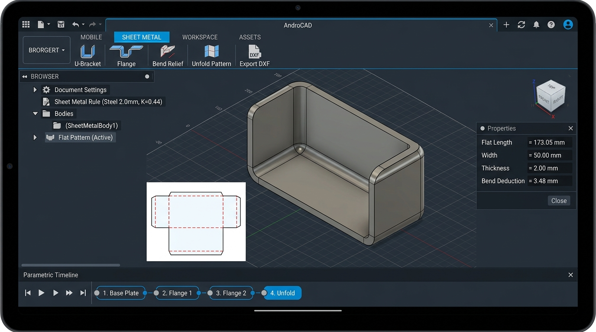
*Sheet Metal workspace: Parametric 3D U-Bracket with analytical K-factor bend deduction ($K = 0.44$), inner/outer cylindrical fillets ($R = 2.0\text{ mm}$), real-time 2D flat pattern layout unrolling with directional bend lines ($90^\circ\text{ UP}$), and direct AutoCAD DXF export for CNC laser cutting.*

### 2D Engineering Drawings & Drafting Sheet (ANSI / ISO)
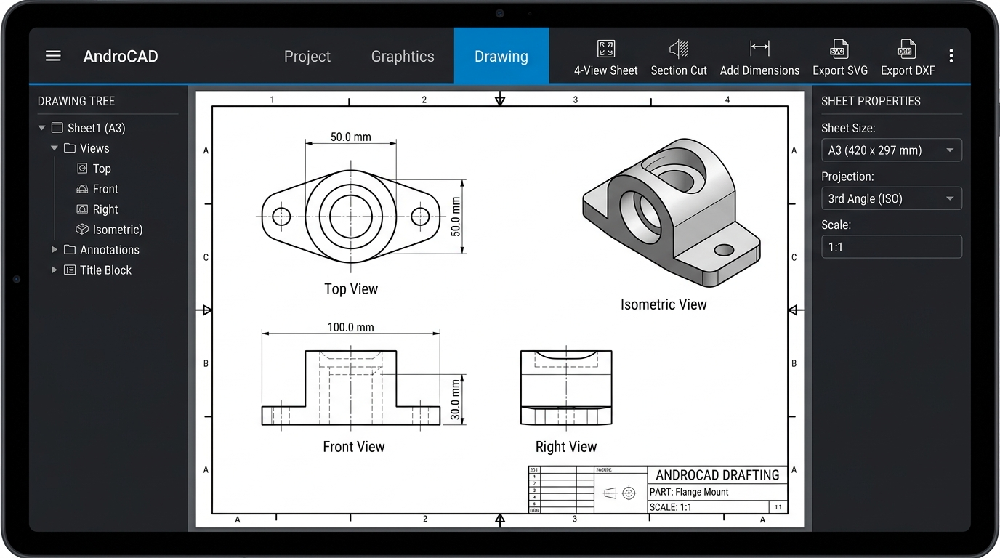
*2D Drawing workspace: Automated 4-view orthographic projection (Top, Front, Right, Isometric in 3rd Angle Projection) on standard A3 engineering sheet, Hidden Line Removal (HLR dashed occluded edges), automatic linear and radial dimension callouts, section cut views with 45° cross-hatching, ISO title block, and multi-format vector SVG/AutoCAD DXF export.*

### Materials, Mass Physical Properties & PBR Visualization
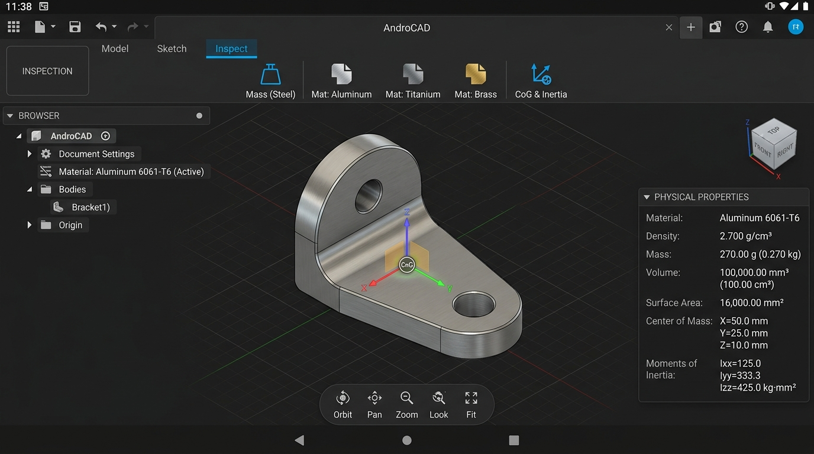
*Inspect & Render workspace: Engineering materials physics library (Steel, 6061-T6 Aluminum, Brass, Titanium, Plastics, Wood) with exact analytical volume, surface area, mass, 3D Center-of-Gravity (CoG) coordinate tripod badge, mass moments of inertia ($I_{xx}, I_{yy}, I_{zz}$), and photorealistic PBR metallic-roughness rendering.*

### Mesh Workspace & Scan-to-CAD Reverse Engineering
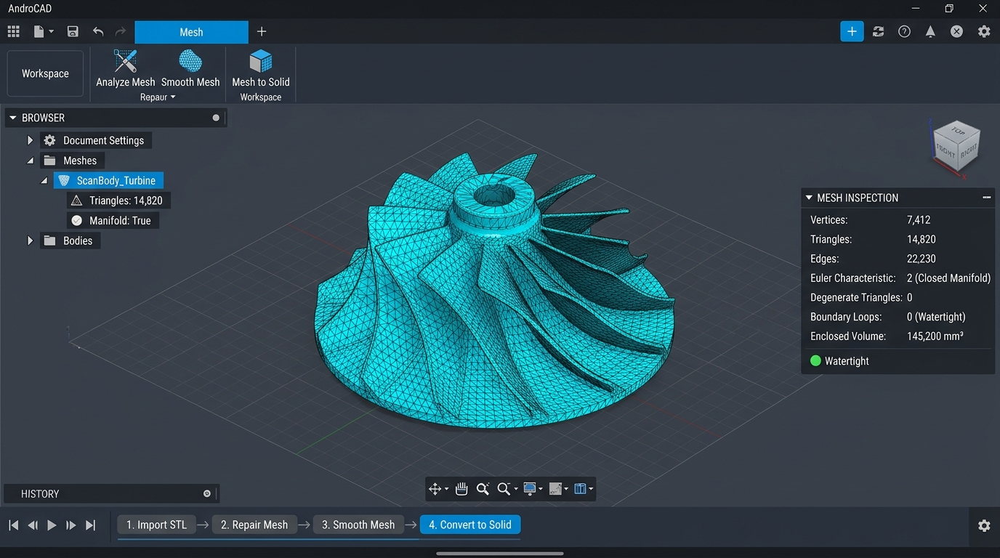
*Mesh workspace: Triangle mesh manipulation, topology analysis (Euler characteristic $\chi = 2$, boundary loops, manifold checks), vertex welding repair, volume-preserving Laplacian smoothing filter, and direct conversion of high-density 3D scans into watertight parametric B-Rep solids.*

### Linear Static Stress Simulation & FEA Heatmap
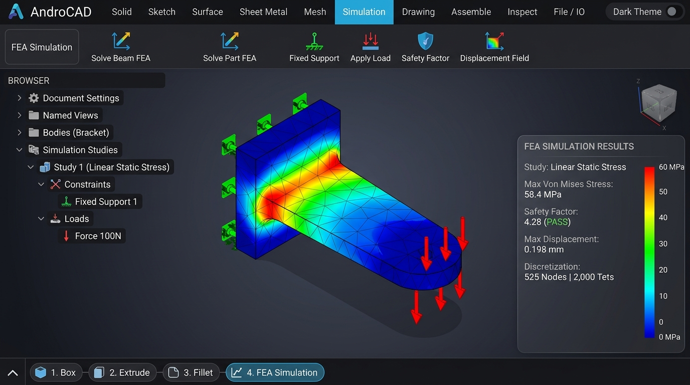
*Simulation workspace: Embedded 3D linear elastic finite element analysis (FEA), tetrahedral volume discretization, fixed and roller boundary constraints, structural force and pressure loads, Preconditioned Conjugate Gradient (PCG) solver, Von Mises stress heatmap (Turbo rainbow colormap), Factor of Safety (FOS) evaluation, and real-time exaggerated deformation visualization.*

### Subtractive CAM & G-Code Post-Processing
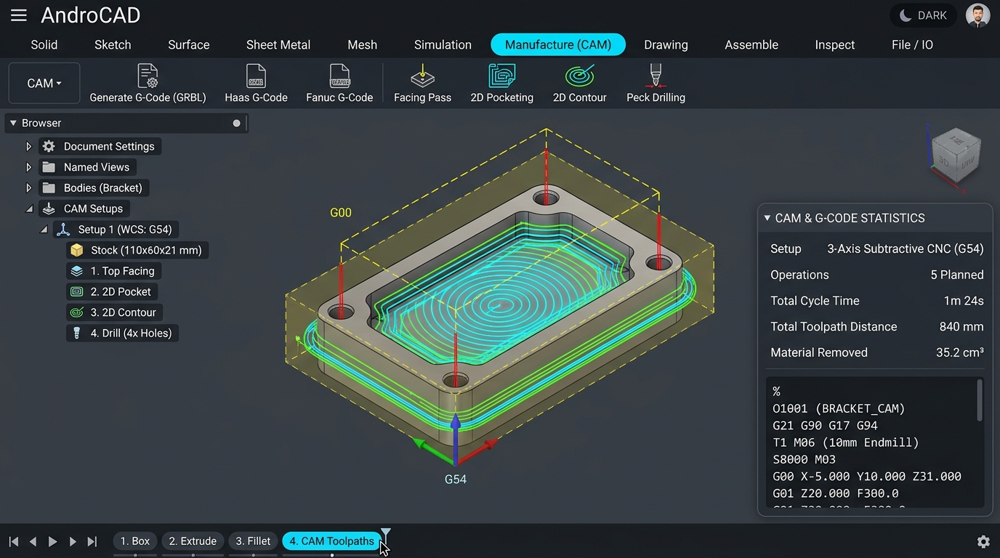
*Manufacture (CAM) workspace: 2.5D and 3-axis CNC subtractive machining, stock and WCS setup (G54), tool library management, facing, 2D concentric pocket clearing, 2D contour perimeter finishing with cutter radius compensation, canned deep-hole peck drilling cycles (G83), 3D toolpath wireframe visualization, and multi-dialect G-Code post-processing (ISO/GRBL, Haas CNC, Fanuc).*

### Patterns, Symmetry & Feature Replicators (Tablet & Mobile Phone)
| Landscape Tablet Workstation UI | Portrait Mobile Phone UI |
| :---: | :---: |
|  |  |

*Solid modeling expansion: 2D Rectangular linear pattern grid arrays ($U \times V$), polar Circular arrays with angular range distribution, planar Mirror symmetry across datum planes (`gp_Trsf::SetMirror`), and Draft Angle injection mold tapers. Features both tablet multi-pane workstation layout and adaptive mobile phone drawer interface.*

### Threads, Fasteners & Associative Sketch Projection (Tablet & Mobile Phone)
| Landscape Tablet Workstation UI | Portrait Mobile Phone UI |
| :---: | :---: |
| 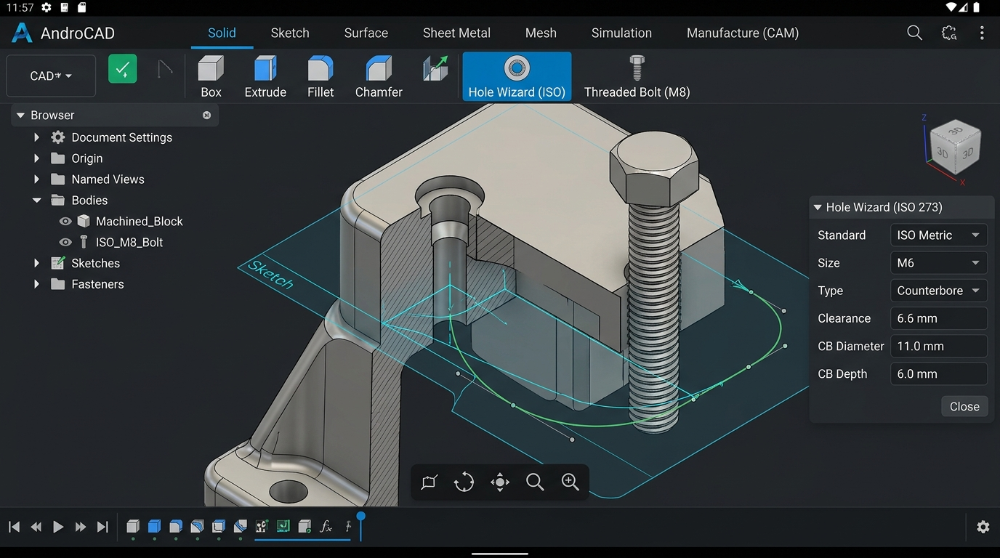 | 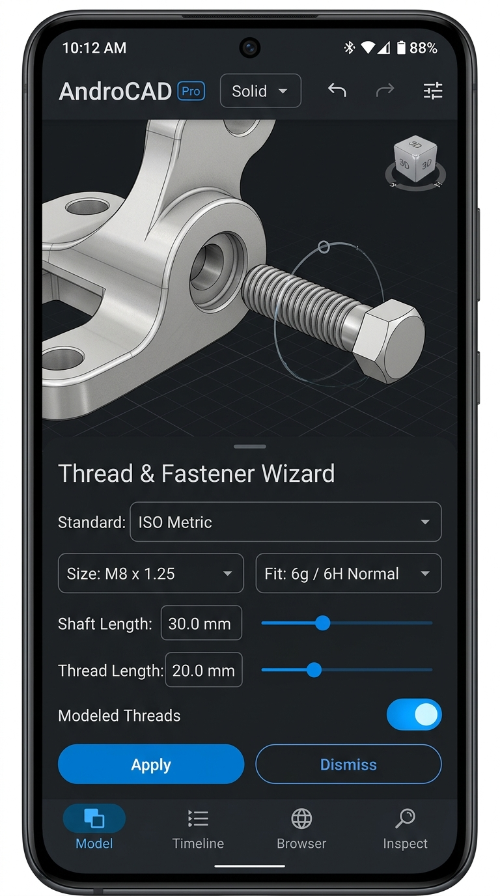 |

*Mechanical standard engineering workspace: Standard Hole Wizard per ISO 273/262 (Counterbore, Countersink, Clearance, Tapped holes M3–M12), modeled 3D physical helical thread tooth geometry for fasteners and bolts, associative 3D edge projection onto 2D sketch planes, and $C^2$ continuous cubic B-Spline curve generation with tangency handles.*

### 3D CAM Surfacing & Additive 3D Print Slicing (Tablet & Mobile Phone)
| Landscape Tablet Workstation UI | Portrait Mobile Phone UI |
| :---: | :---: |
| 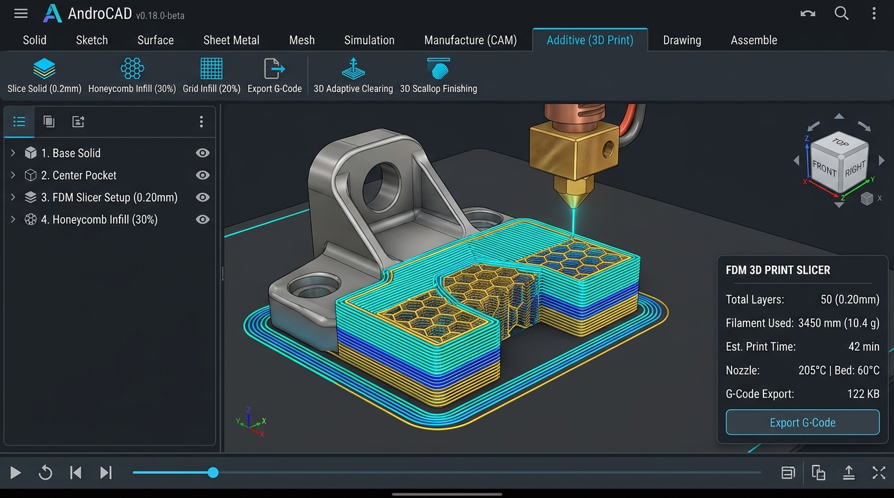 | 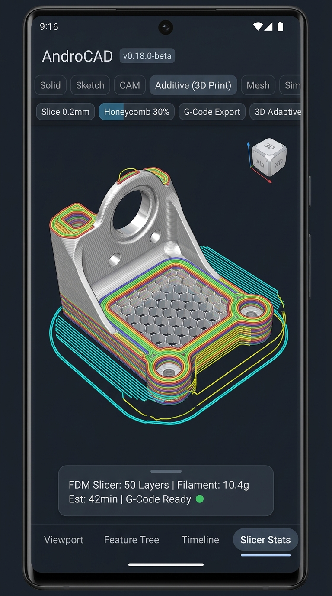 |

*Advanced manufacturing suite: 3D sculpted toolpaths (3D Adaptive Clearing with constant tool engagement angle, 3D Scallop constant cusp height finishing, and 3D Parallel raster surfacing) alongside native FDM 3D printer slicing directly on Android devices. Features configurable layer height (0.10–0.40mm), wall perimeters, infill patterns (Rectilinear and Honeycomb hexagonal lattice), filament volume/mass calculations, and RepRap/Marlin standard G-code generation with nozzle and bed thermal management.*

### High-Precision FEA (Tet10) & Modal Vibration Analysis (Tablet & Mobile Phone)
| Landscape Tablet Workstation UI | Portrait Mobile Phone UI |
| :---: | :---: |
| 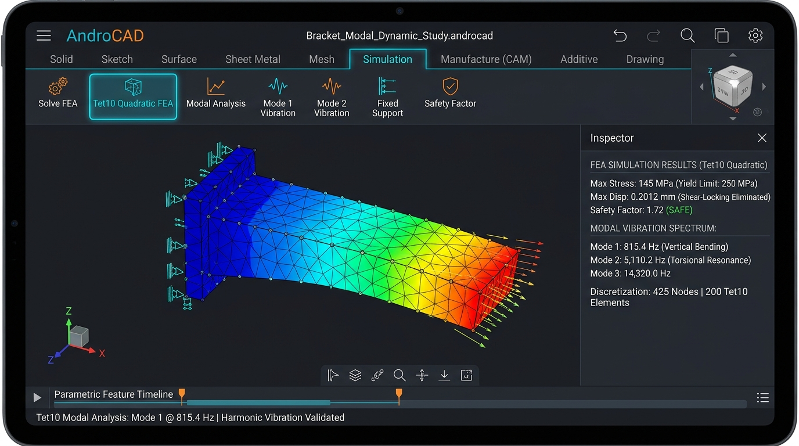 | 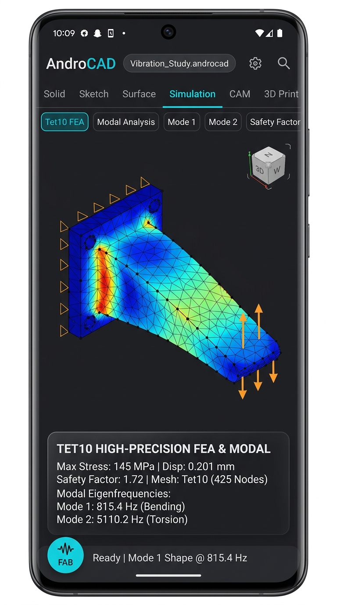 |

*Advanced structural simulation: 10-node quadratic tetrahedral elements (Tet10 with 4 corner vertices and 6 midside nodes) eliminating shear locking in thin bending plates and beams, evaluated with 4-point Keast/Hammer Gauss quadrature. Includes a dynamic Free Vibration and Modal Natural Frequency eigenvalue solver ($(\mathbf{K} - \omega^2 \mathbf{M})\mathbf{\phi} = 0$) using PCG-accelerated inverse power iteration with Hinton-Rock-Zienkiewicz (HRZ) diagonal mass lumping, extracting fundamental bending, torsional, and harmonic resonance frequencies alongside real-time animated mode shape deformation meshes.*

### GD&T, Bill of Materials (BOM) & Multi-Sheet Vector Drafting (Tablet & Mobile Phone)
| Landscape Tablet Workstation UI | Portrait Mobile Phone UI |
| :---: | :---: |
|  |  |

*Production engineering documentation suite: Complete ASME Y14.5 / ISO 1101 Geometric Dimensioning & Tolerancing (GD&T) Feature Control Frames (Position ⌖, Flatness ⏥, Perpendicularity ⟂, Parallelism ∥, Cylindricity ⌭, Total Runout ⌰) with Material Condition modifiers (MMC Ⓜ, LMC Ⓛ) and Datum reference targets [A | B | C]. Features automated Assembly Bill of Materials (BOM) schedule extraction, circular callout balloons with leader lines, circular magnified Detail Views (2:1 scale), auxiliary oblique projection views, and multi-sheet vector SVG and multi-layer AutoCAD DXF export (BORDER, VISIBLE, HIDDEN, DIMENSIONS).*

---

## Key Features & Architecture

* **Geometry Kernel:** Open CASCADE Technology (OCCT 7.8.0), modularized and cross-compiled for Android `arm64-v8a` and `x86_64` using Android NDK r26d.
* **Sketch Constraint Solver:** PlaneGCS (Levenberg-Marquardt / Dogleg non-linear solver) dynamically linked for full 2D geometric and dimensional constraint solving.
* **Parametric DAG Timeline:** Transactional recomputation engine with rollback markers, named user parameters (`width * 2`), and deterministic topological reconstruction.
* **Persistent Naming (TNP):** 3-tier topological naming resolution (semantic tags -> `BRepTools_History` tracking -> invariant geometric fingerprints) preventing broken downstream fillets and sketches.
* **Rendering Architecture:** Native C++ OpenGL ES 3.x zero-copy pipeline streaming `BRepMesh` boundary tessellation and sharp edge primitives directly to GPU VBOs. Includes $O(1)$ GPU color picking for faces and edges.
* **Tablet Gestures & Stylus:** Pinch-to-zoom, two-finger pan, one-finger orbit, double-tap zoom to fit, two-finger tap for Undo, and three-finger tap for Redo.
* **Responsive Layout:** Full 3-pane desktop-style CAD layout on tablets (`>= 600dp`); streamlined full-viewport editor with bottom drawer sheets on phones.
* **CAD Data Exchange:** Native versioned `.androcad` JSON project serializer, standard STEP AP214/AP242 import/export, and binary STL import/export.
* **Dark & Light Themes:** Instant toggle between high-contrast CAD dark theme and clean engineering light theme.
* **Original CAD Iconography:** 100% original SVG CAD icons (Extrude, Revolve, Fillet, Chamfer, Hole, Shell, Combine, Sketch).

---

## Legal & Licensing Information

* **Application Code:**  
  Copyright (c) 2026 dursuntokgoz. **All rights reserved.**  
  No permission is granted to use, copy, modify, merge, publish, distribute, sublicense, or sell copies of this proprietary software without the prior written permission of the copyright holder.

* **Third-Party Open-Source Components:**  
  Third-party components, including Open CASCADE Technology (OCCT 7.8.0), PlaneGCS, Eigen 3, and Boost, are licensed under their respective open-source licenses. OCCT and PlaneGCS are dynamically linked as standalone shared libraries (`.so`).  
  For complete licensing terms, notices, and dynamic relinking instructions satisfying LGPL 2.1 Section 6, please refer to [`THIRD_PARTY_NOTICES.md`](./THIRD_PARTY_NOTICES.md) and [`docs/licenses.md`](./docs/licenses.md).

---

## Documentation & Milestone Reports

* **[Session History & Multi-Machine Handoff Ledger](docs/SESSION_HISTORY.md)** *(Start here when resuming work on another machine)*
* [Roadmap & Decisions Log](docs/roadmap.md)
* [Third-Party Licenses & Compliance Ledger](docs/licenses.md)
* [Milestone 1 Report: OCCT Android Build & JNI Smoke Test](docs/reports/milestone-1.md)
* [Milestone 2 Report: Native Viewport & Picking Engine](docs/reports/milestone-2.md)
* [Milestone 3 Report: 2D Sketcher with PlaneGCS](docs/reports/milestone-3.md)
* [Milestone 4 Report: 3D Parametric Features](docs/reports/milestone-4.md)
* [Milestone 5 Report: Parametric Timeline & Persistent Naming](docs/reports/milestone-5.md)
* [Milestone 6 Report: Versioned Project I/O & Data Exchange](docs/reports/milestone-6.md)
* [Milestone 7 Report: UI Polish, Tablet Gestures, Phone Layout & Assets](docs/reports/milestone-7.md)
* [Milestone 8 Report: Advanced Surface Modeling & Direct Editing](docs/reports/milestone-8.md)
* [Milestone 9 Report: Multi-Component Assemblies & Kinematic Joints](docs/reports/milestone-9.md)
* [Milestone 10 Report: Sheet Metal Engine, K-Factor Bends & Flat Pattern Unfolding](docs/reports/milestone-10.md)
* [Milestone 11 Report: 2D Engineering Drawings, Orthographic Views & Dimension Drafting](docs/reports/milestone-11.md)
* [Milestone 12 Report: Engineering Materials, Mass Physical Properties & PBR Visualization](docs/reports/milestone-12.md)
* [Milestone 13 Report: Mesh Workspace & Scan-to-CAD Reverse Engineering](docs/reports/milestone-13.md)
* [Milestone 14 Report: Linear Static Stress Simulation & FEA Heatmap](docs/reports/milestone-14.md)
* [Milestone 15 Report: Subtractive CAM & G-Code Post-Processing](docs/reports/milestone-15.md)
* [Milestone 16 Report: Patterns, Symmetry & Feature Replicators](docs/reports/milestone-16.md)
* [Milestone 17 Report: Threads, Fasteners & Associative Sketch Projection](docs/reports/milestone-17.md)
* [Milestone 18 Report: 3D CAM Surfacing & Additive 3D Print Slicing](docs/reports/milestone-18.md)
* [Milestone 19 Report: High-Precision FEA (Tet10 Quadratic Tetrahedrals) & Modal Vibration Analysis](docs/reports/milestone-19.md)
* [Milestone 20 Report: GD&T, Bill of Materials (BOM) & Multi-Sheet Vector Drafting](docs/reports/milestone-20.md)
