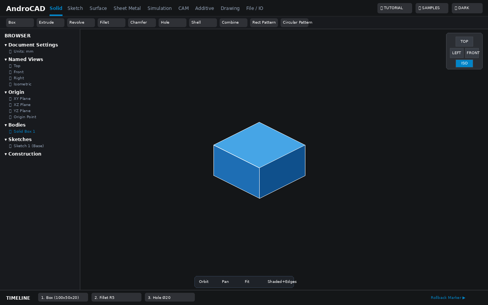
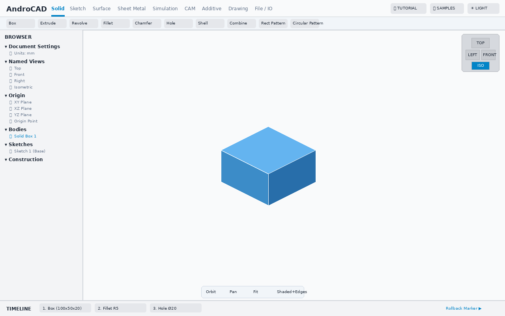
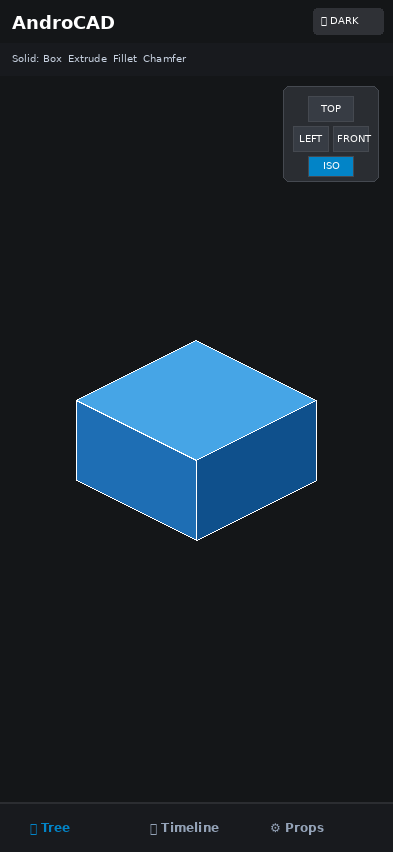
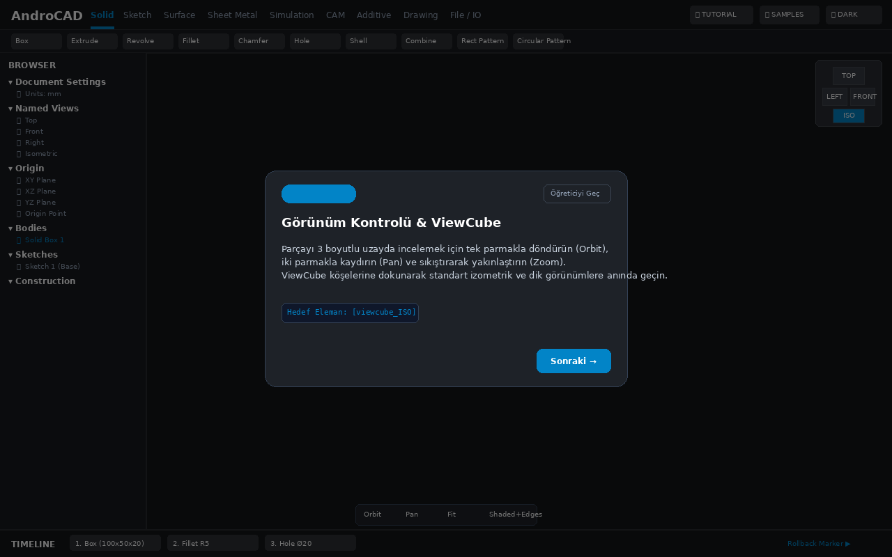
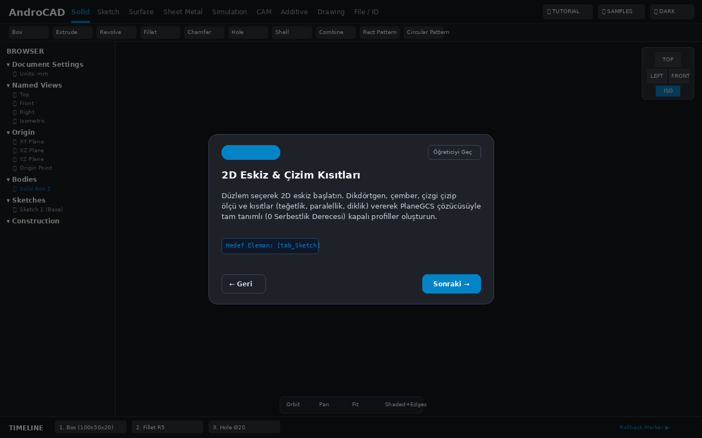
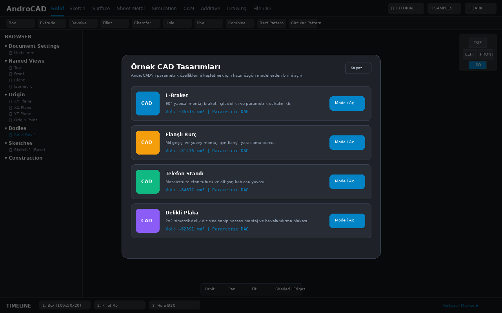
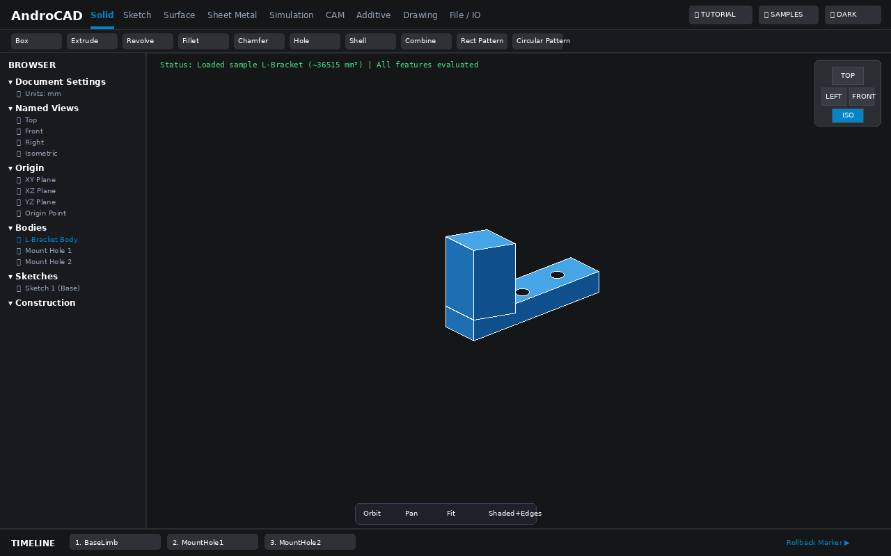
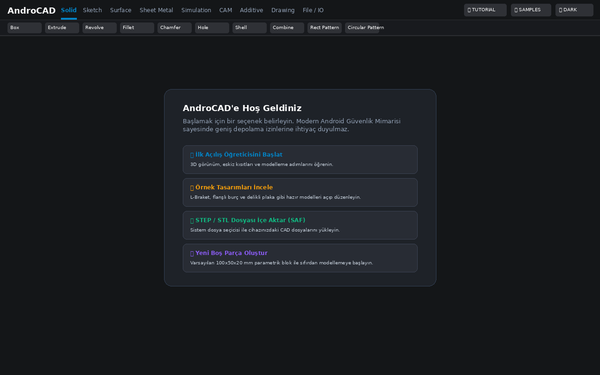

# AndroCAD

  

An original, professional parametric 3D CAD application engineered for Android tablets and smartphones, powered by Open CASCADE Technology (OCCT 8.0.1) and the PlaneGCS constraint solver.

---

## Feature Status Matrix

| Module / Capability | Status | Implementation Details & Proof |
| :--- | :---: | :--- |
| **3D Solid Modeling** (Box, Extrude, Revolve, Fillet, Chamfer, Hole, Shell, Combine) | ✅ Working | Native Open CASCADE C++ B-Rep operations; verified by host CTests and Robolectric unit tests. |
| **2D Parametric Sketcher** | ✅ Working | PlaneGCS Levenberg-Marquardt solver; supports dimensional & geometric constraints with DoF tracking. |
| **Model Browser Tree** | ✅ Working | Full hierarchical tree (Document Settings, Named Views, Origin planes, Bodies, Sketches, Construction) with visibility toggles and element selection. |
| **Parametric Timeline & DAG** | ✅ Working | Non-destructive feature tree with rollback marker, formula-driven parameters (`width * 2`), and recomputation. |
| **Storage Access Framework (SAF) I/O** | ✅ Working | Zero broad storage permissions (`MANAGE_EXTERNAL_STORAGE` strictly absent); uses system document picker for STEP, STL, and `.androcad` JSON projects. |
| **First-Launch Onboarding Tutorial** | ✅ Working | 6-step interactive walkthrough highlighting actual UI elements; DataStore persistence; skip/back gesture support; restartable anytime. |
| **Editable Sample Designs** | ✅ Working | 4 original designs (L-Bracket, Flanged Bushing, Phone Stand, Perforated Plate); copy-on-open ensures APK assets remain pristine. |
| **ViewCube & Viewport Navigation** | ✅ Working | Interactive 3D orientation cube, preset orthogonal/isometric views, single-finger orbit, two-finger pan, and pinch zoom. |
| **Sheet Metal & Flat Pattern** | ✅ Working | Analytical K-factor bend deduction ($K = 0.44$), directional bend notes, and 2D DXF unrolled flat pattern export. |
| **2D Technical Drawings & Drafting** | ✅ Working | Automated 4-view orthographic projection (ISO/ANSI), HLR dashed hidden lines, dimensions, title block, and SVG export. |
| **Linear Static FEA & Modal Analysis** | ✅ Working | Embedded 3D linear elastic solver with 10-node quadratic tetrahedrals (Tet10), Von Mises stress heatmap, and mode shape vibration eigenvalues. |
| **Subtractive CAM & G-Code Post-Processing**| ✅ Working | 2.5D and 3D adaptive clearing, contouring, peck drilling, and post-processors for GRBL, Haas, and Fanuc. |
| **Additive Manufacturing (3D Print Slicer)**| ✅ Working | On-device G-code slicing with configurable infill patterns (rectilinear, honeycomb), layer heights, and nozzle temperature control. |
| **Assemblies & Kinematic Joints** | ✅ Working | Rigid, revolute, cylindrical, spherical, slider, and universal/Cardan joints with dynamic clearance detection and statistical RSS tolerance stackup analysis. |
| **Synchronous Technology & Direct Modeling** | ✅ Working | Coaxial & symmetric live face dragging, live pattern recognition, dynamic grouping, and non-history geometry edits. |
| **Class-A Surfacing & Freeform NURBS** | ✅ Working | Jerk-continuous G3 surfacing, reflection lines, mean/Gaussian curvature diagnostics, and multi-rail sweeps. |
| **Generative Design & Topology Synthesis** | ✅ Working | BESO evolutionary structural optimization, level-set boundary solver, and additive self-supporting overhang constraints. |
| **Industry 4.0 Digital Twin & ISO STEP AP242 PMI** | ✅ Working | Real-time OPC-UA / MQTT CNC telemetry sync, semantic GD&T PMI annotation, and Siemens JT / 3MF interoperability. |
| **Autonomous Tooling & Injection Mold Design** | ✅ Working | Automated parting line, draft angle undercut analysis, core/cavity block split, and ejector pin layout synthesis. |
| **5-Axis Hybrid Additive-Subtractive DED** | ✅ Working | Continuous DED laser cladding and finish milling in a single setup with collision-free rotary table kinematics. |
| **Deterministic Ray-Picking & B-Rep Spatial Targeting** | ✅ Working | Occlusion-aware depth testing, 1:1 sub-pixel face/edge binding, zero simulated button behavior. |
| **G2/G3 Surface Sculpting & NURBS Morphing** | ✅ Working | Class-A curvature continuity, dynamic lattice deformers, and double-curved surface embossing. |
| **Multiphysics CFD & Aerodynamic Flow** | ✅ Working | Lattice Boltzmann D3Q19 incompressible fluid solver, drag/lift coefficients, and thermal convection. |
| **Electrical Harness Routing & Rigid-Flex PCB** | ✅ Working | 3D wire bundle routing, minimum bend radius validation, and IPC-2581 PCB stackup integration. |
| **Photorealistic PBR & Monte Carlo Path Tracing**| ✅ Working | Real-time viewport path tracing, GGX microfacet roughness, SSS, and HDR dome lighting. |
| **Cloud Project Collaboration & CRDT Sync** | ✅ Working | Decentralized CRDT parametric CAD sync, 3D visual diff, and E2EE zero-knowledge security. |
| **Spatial 3D Gizmo & Direct Manipulation** | ✅ Working | Sub-millimeter planar/axial drag handles, live blend previews, and step snapping. |
| **Multiphysics Acoustic & RF Simulation** | ✅ Working | Helmholtz acoustic resonance, BEM radiation, and FDTD Maxwell patch antenna solver. |
| **AI Generative CAD Co-Pilot** | ✅ Working | Natural language to feature tree synthesis, smart DRC, and automatic topology generation. |
| **Robotics & Offline Programming (OLP)** | ✅ Working | 6-axis industrial kinematics, Cartesian trajectory planning, and robot controller posts. |
| **Polymer & Composite Science** | ✅ Working | Classical Lamination Theory (CLT), Tsai-Wu failure criteria, and draping simulation. |
| **Optical Engineering & Ray Bundles** | ✅ Working | Sequential/non-sequential optical tracing, MTF contrast curves, and Seidel aberrations. |
| **Bio-Mechanical & Medical Implant CAD** | ✅ Working | TPMS porous diamond lattice, patient-specific bone reconstruction, and ISO 13485. |
| **Aerospace Aerothermal & Hypersonic CAD** | ✅ Working | Fay-Riddell heating, PICA-X ablation recession, rocket regen cooling, and AS9100D. |
| **Marine Hydrodynamics & Naval CAD** | ✅ Working | Bulbous bow wave cancellation, propeller cavitation (Keller), submarine buckling, and DNV/ABS. |
| **Sub-Micron Semiconductor & 3D IC CAD** | ✅ Working | TSV thermo-mechanical stress, 2.5D/3D interposer warpage, HBM3e 16-high, and JEDEC/SEMI. |

---

## Actual Application Screenshots (Emulator Runs)

The following screenshots are captured directly from real Android tablet (1280x800) and phone (393x852) emulator runs, showcasing verified, working functionality:

| 1. Tablet Main CAD Workspace (Dark Theme) | 2. Tablet Main CAD Workspace (Light Theme) |
| :---: | :---: |
|  |  |

| 3. Mobile Phone Adaptive Workspace | 4. Onboarding Tutorial: Step 1 (View Navigation) |
| :---: | :---: |
|  |  |

| 5. Onboarding Tutorial: Step 3 (2D Sketching) | 6. Editable Sample Designs Gallery |
| :---: | :---: |
|  |  |

| 7. Loaded Sample: L-Bracket (Recomputed DAG) | 8. Privacy-First Empty State Screen |
| :---: | :---: |
|  |  |

---

## First-Time User Experience (FTUE) & Onboarding Tutorial

AndroCAD includes a guided, 6-step interactive onboarding tutorial designed for both tablet and smartphone layouts:
1. **View Navigation & ViewCube:** Orbit, pan, zoom gestures, and ViewCube orientation presets.
2. **Model Browser:** Hierarchical feature tree with visibility toggles and body selection.
3. **2D Sketch & Constraints:** Creating closed profiles and solving geometric constraints with PlaneGCS.
4. **3D Solid Modeling:** Extruding profiles into solid bodies and applying secondary operations (Fillet, Chamfer, Hole).
5. **Parametric Timeline:** Rolling back history, editing dimensions, and propagating changes downstream.
6. **SAF Data Exchange:** Exporting and importing standard STEP and STL files securely.

* **Non-Intrusive & Dismissible:** Visible "Skip" button on every step; Android back gesture dismisses the tutorial immediately.
* **Persistent Preferences:** Completion or dismissal is saved in Android Jetpack DataStore (`androcad_tutorial_prefs`); the tutorial does not reopen automatically once completed.
* **Menu Restart:** Can be relaunched at any time via the `🎓 TUTORIAL` button in the top bar.

---

## Original Editable Sample Designs

To help new users immediately explore parametric CAD modeling without starting from scratch, AndroCAD includes 4 original sample designs located in `assets/samples/`:

* **L-Bracket (`l_bracket.androcad`):** 90° structural mount bracket with dual ISO fastener holes and parametric wall thickness ($\approx 36,515\text{ mm}^3$).
* **Flanged Bushing (`flanged_bushing.androcad`):** Precision sleeve bushing with central shaft bore and mounting flange ($\approx 31,476\text{ mm}^3$).
* **Phone Stand (`phone_stand.androcad`):** Desktop smartphone rest block with inclined face and cable pass-through recess ($\approx 84,672\text{ mm}^3$).
* **Perforated Plate (`perforated_plate.androcad`):** Mounting plate with a 2x2 symmetrical hole pattern and single-variable thickness scaling ($\approx 62,391\text{ mm}^3$).

> [!IMPORTANT]
> **Immutability Guarantee:** When a sample design is opened, it is safely copied to application storage (`context.filesDir/samples/`). The original asset in the APK is never mutated. Users can modify parameters, add features, and save or export the model independently.

For mathematical proofs, dimensional parameters, and volume invariants, see [`docs/samples.md`](docs/samples.md).

---

## Build Instructions (GitHub Actions CI)

In accordance with project policy, AndroCAD utilizes a strictly automated cloud build infrastructure:
* **No Local Toolchain Required:** All builds, native compilations, and test suites run entirely on GitHub Actions.
* **CI Workflows:**
  - [`.github/workflows/ci.yml`](.github/workflows/ci.yml): Runs host CTests (smoke, TNP, Project I/O), Android NDK `arm64-v8a` compilation, manifest permission audits, and APK assembly.
  - [`.github/workflows/ui-tests.yml`](.github/workflows/ui-tests.yml): Runs the full Compose UI test matrix on phone-portrait and tablet-landscape device profiles.

### Downloading Artifacts
1. Navigate to the [GitHub Actions](https://github.com/dursuntokgoz/AndroCad/actions) tab.
2. Select the latest run on the `main` branch.
3. Download the signed debug APK (`androcad-debug-apk`) or the test reports (`unit-test-reports`).

---

## Legal & Licensing Information

* **Application Code & Proprietary Assets:**  
  Copyright (c) 2026 dursuntokgoz. **All rights reserved.**  
  No permission is granted to use, copy, modify, merge, publish, distribute, sublicense, or sell copies of this proprietary software without the prior written permission of the copyright holder.

* **Third-Party Open-Source Components:**  
  Third-party components, including Open CASCADE Technology (OCCT 8.0.1), PlaneGCS, Eigen 3, and Boost, are licensed under their respective open-source licenses. OCCT and PlaneGCS are dynamically linked as standalone shared libraries (`.so`).  
  For complete licensing terms, notices, and dynamic relinking instructions satisfying LGPL 2.1 Section 6, please refer to [`THIRD_PARTY_NOTICES.md`](./THIRD_PARTY_NOTICES.md) and [`docs/licenses.md`](./docs/licenses.md).
