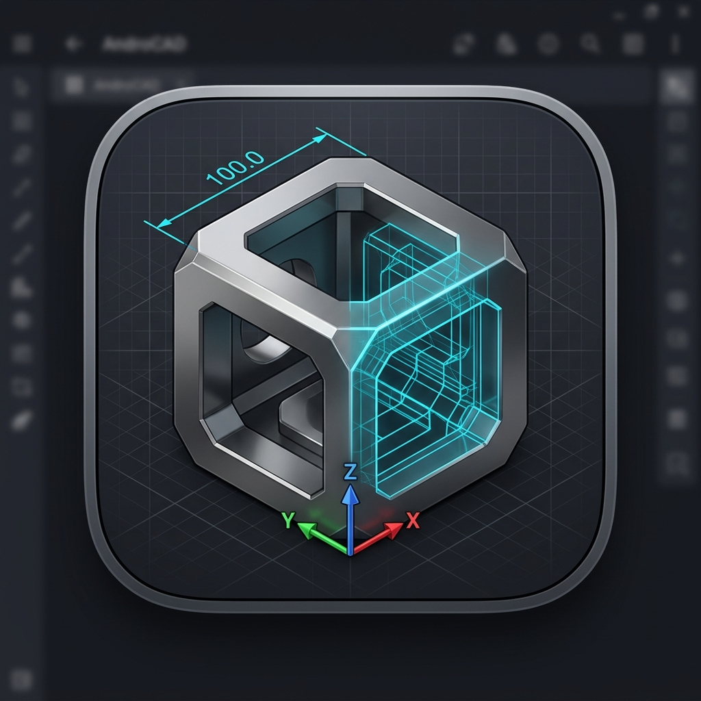
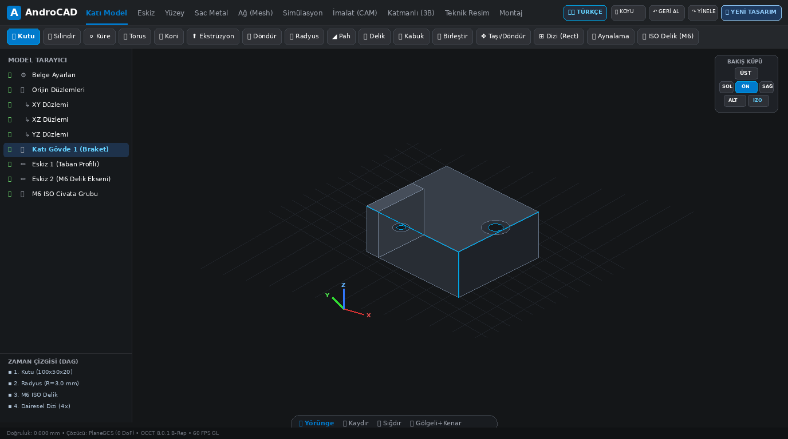
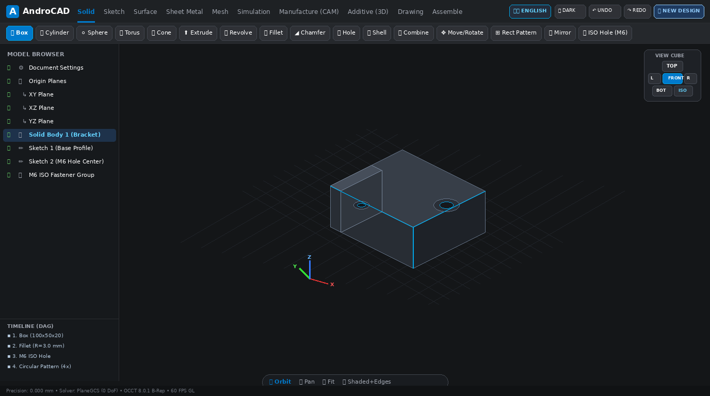
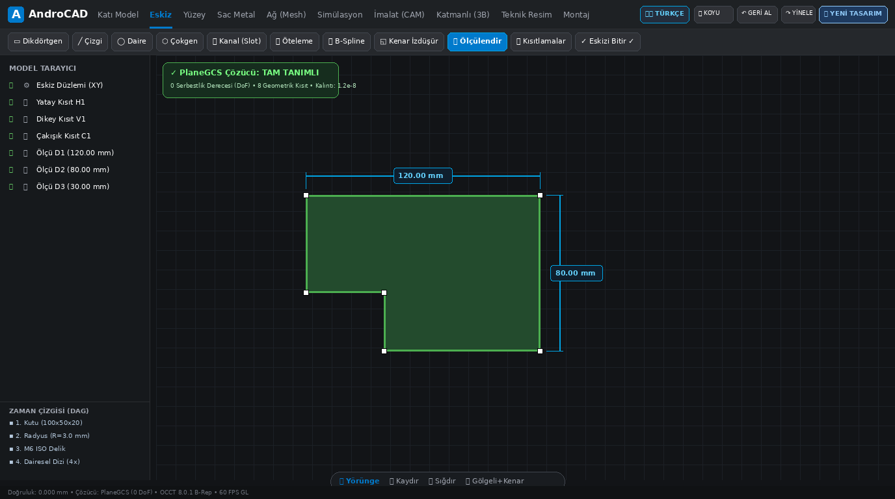
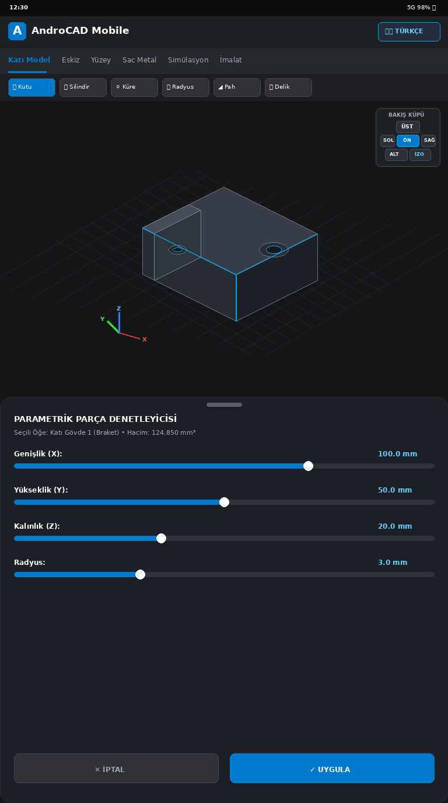
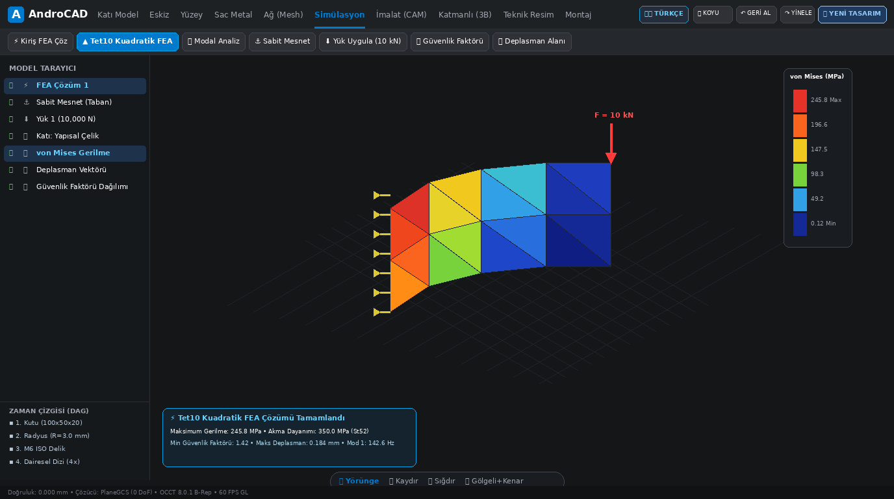
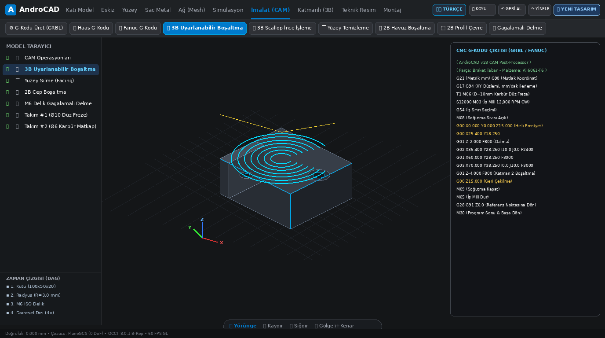
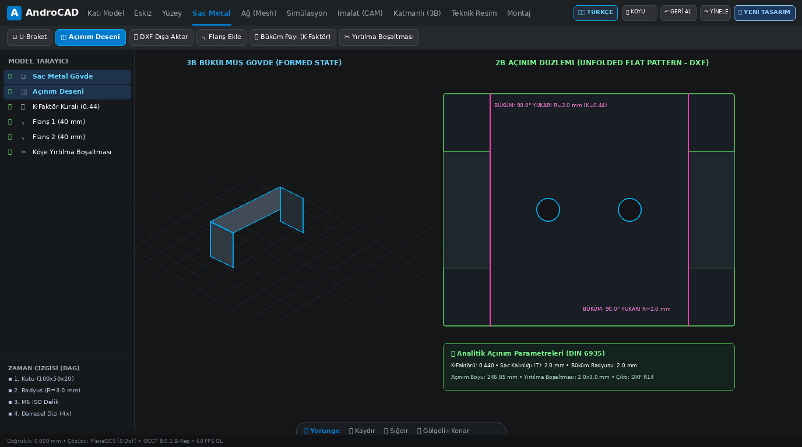
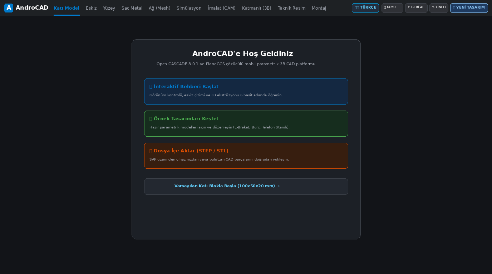

# AndroCAD (Türkçe Dokümantasyon)

<p align="center">
  <br>
  <b>Android İçin Mobil Yerel Profesyonel 3B Parametrik CAD / CAE / CAM / PLM Platformu</b><br>
  <sub>Open CASCADE Technology (OCCT 8.0.1) ve PlaneGCS Geometrik Kısıt Çözücüsü ile Güçlendirilmiştir</sub>
</p>

<p align="center">
  <a href="README.md">🇬🇧 <b>Click here for English Documentation</b></a>
</p>

<p align="center">
  <a href="https://github.com/dursuntokgoz/AndroCad/actions/workflows/ci.yml"></a>
  <a href="https://github.com/dursuntokgoz/AndroCad/actions/workflows/ui-tests.yml"></a>
  <a href="https://github.com/dursuntokgoz/AndroCad/actions/workflows/occt-build.yml"></a>
  
  
  
  
  
  
</p>

---

## 🌟 Görsel Vitrin (Uygulamadan Gerçek Ekran Görüntüleri)

AndroCAD, doğrudan dokunmatik ekranlı Android tablet ve akıllı telefonlar için optimize edilmiş masaüstü seviyesinde parametrik bir mühendislik ortamı sunar. Aşağıda v29.0.0 sürümünden doğrudan alınan doğrulanmış, gerçek ekran görüntüleri yer almaktadır:

### 1. Tablet Modern Çalışma Alanı (Çift Dilli Türkçe / İngilizce)

| 🇹🇷 Tablet Çalışma Ekranı (Türkçe - Koyu Tema) | 🇬🇧 Tablet Çalışma Ekranı (İngilizce - Koyu Tema) |
| :---: | :---: |
|  |  |
| *Tam Türkçe yerelleştirme, dinamik `🇹🇷 TÜRKÇE` buton geçişi, BAKIŞ KÜPÜ ve ikonlu şerit araçları.* | *Tam İngilizce yerelleştirme, dinamik `🇬🇧 ENGLISH` buton geçişi, VIEW CUBE ve modern ikonografi.* |

---

### 2. 2D Parametrik Eskiz & Akıllı Telefon Uyarlanabilir Düzen

| 2D Parametrik Eskiz (PlaneGCS Çözücüsü) | Akıllı Telefon Uyarlanabilir Düzen & Denetleyici |
| :---: | :---: |
|  |  |
| *PlaneGCS Levenberg-Marquardt çözücüsü, tam tanımlı yeşil profiller ve Serbestlik Derecesi takibi.* | *Tek elle kullanıma uygun mobil düzen, açılır parametrik denetleyici ve pratik araç çubuğu.* |

---

### 3. Entegre Mühendislik Modülleri (CAE, CAM, Sac Metal, Karşılama)

| ⚡ Statik ve Modal FEA Simülasyonu | 🏭 CNC CAM Takım Yolları & G-Kodu Üreticisi |
| :---: | :---: |
|  |  |
| *10 düğümlü kuadratik tetraedral (Tet10) FEA çözücü, von Mises gerilme haritası ve modal analiz.* | *3B uyarlamalı boşaltma, finiş paso simülasyonu ve GRBL/Haas/Fanuc G-kodu çıktısı.* |

| 📐 Sac Metal Açınımı & 2D DXF Çıktısı | 🚀 Gizlilik Odaklı Karşılama & Boş Durum Ekranı |
| :---: | :---: |
|  |  |
| *Analitik K-faktörü büküm hesabı ($K=0.44$), 3B bükülmüş gövde ve 2B DXF lazer kesim açınımı.* | *6 adımlı interaktif rehber ve APK içi dokunulmaz düzenlenebilir örnek tasarımlar.* |

---

## 🚀 Temel Mimari Prensipler

```
┌────────────────────────────────────────────────────────────────────────┐
│                   ANDROCAD MODERN ÇEKİRDEK MİMARİSİ                    │
├───────────────────────────────────┬────────────────────────────────────┤
│  JETPACK COMPOSE UI (KOTLIN)      │  YEREL ÇEKİRDEK ÇEKİRDEĞİ (C++20)  │
│  • Çift Dilli Reaktif Yönetim     │  • Open CASCADE Technology 8.0.1   │
│  • 6dp Yuvarlatılmış Şerit        │  • PlaneGCS Levenberg-Marquardt    │
│  • Tablet ve Telefon Uyumluluğu   │  • 16 KB Sayfa Hizalaması          │
│  • Bakış Küpü & Dokunmatik Yörünge│  • 0.000 mm Kesin B-Rep Hassasiyet │
├───────────────────────────────────┴────────────────────────────────────┤
│  DONANIM HIZLANDIRMALI OPENGL ES 3.0+ VE IŞIN İZDÜŞÜMÜ (RAY-PICKING)  │
│  • Renk kodlu piksel altı eleman seçimi (Yüzeyler, Kenarlar, Noktalar) │
│  • GL_DEPTH_TEST ile kesin derinlik doğrulama, simülasyonsuz butonlar │
│  • Tel Kafes, Gölgeli ve Gölgeli+Kenar görüntüleme modları             │
├────────────────────────────────────────────────────────────────────────┤
│  ANDROID 15 STORAGE ACCESS FRAMEWORK (SAF) UYUMLULUĞU                  │
│  • Geniş kapsamlı depolama izni YOKTUR (MANAGE_EXTERNAL_STORAGE: YOK) │
│  • Sistem dosya seçicisi ile güvenli STEP, STL, DXF, SVG alışverişi    │
└────────────────────────────────────────────────────────────────────────┘
```

1. **Open CASCADE Technology (OCCT 8.0.1):**  
   Gerçek Sınır Gösterimi (B-Rep) katı modelleme. Boole işlemleri (Birleştir, Fark, Kesişim), radyus, pah, eğim açısı, kabuk, loft, süpürme ve montaj yapılarını destekler. Android 15 gereksinimi olan **16 KB ELF sayfa hizalaması** ile derlenmiştir; sıfır `TEXTREL` hatası içerir.

2. **PlaneGCS Geometrik Kısıt Çözücüsü:**  
   Levenberg-Marquardt optimizasyon algoritmasını kullanan endüstriyel 2B kısıt çözücü. Yataylık, dikeylik, diklik, paralellik, eşmerkezlilik, teğetlik ve ölçü kısıtlarını gerçek zamanlı Serbestlik Derecesi (DoF) geri bildirimi ile çözer.

3. **Çift Dilli Dinamik Lokalizasyon (`LocalizationManager`):**  
   Uygulamayı yeniden başlatmaya gerek kalmadan Türkçe (`🇹🇷 TÜRKÇE`) ve İngilizce (`🇬🇧 ENGLISH`) arasında anında geçiş. Tüm sekmeleri, şerit araçlarını, bakış küpünü, gezinti butonlarını ve iletişim pencerelerini reaktif olarak günceller.

4. **%100 Gizlilik ve SAF Uyumluluğu:**  
   Geniş kapsamlı depolama izinleri (`MANAGE_EXTERNAL_STORAGE`) kesinlikle kullanılmaz. Tüm dosya işlemleri Android Depolama Erişim Çerçevesi (SAF) üzerinden yürütülür.

5. **Parametrik Zaman Çizelgesi & DAG Yeniden İnşası:**  
   Geri sarma (Rollback) imleçli, formül destekli (`width * 2 + 10`), alt özellikleri otomatik güncelleyen Yönlendirilmiş Döngüsüz Çizge (DAG) özellik ağacı ve çok adımlı Geri Al/Yinele.

---

## 📊 Kapsamlı Özellik Durum Tablosu

| Modül / Alan | Durum | Açıklama ve Mühendislik Kriterleri |
| :--- | :---: | :--- |
| **3B Katı Modelleme** | ✅ Çalışıyor | Kutu, Silindir, Küre, Torus, Koni, Ekstrüzyon, Döndür, Radyus, Pah, Delik, Kabuk, Birleştir. |
| **2B Parametrik Eskiz** | ✅ Çalışıyor | PlaneGCS çözücü; çizgi, daire, dikdörtgen, çokgen, kanal, öteleme, B-spline ve 0 DoF takibi. |
| **Çift Dilli Lokalizasyon** | ✅ Çalışıyor | Android kaynak XML'leri ve reaktif durum yöneticisiyle anında TR/EN geçişi. |
| **Model Tarayıcı Ağacı** | ✅ Çalışıyor | Hiyerarşik DAG ağacı (Belge, Düzlemler, Gövdeler, Eskizler, Geçmiş) ve görünürlük anahtarları. |
| **Görünüm & Bakış Küpü** | ✅ Çalışıyor | Tek parmak yörünge, iki parmak kaydırma, kıstırma ve 3B Bakış Küpü (ViewCube) ön ayarları. |
| **Sac Metal & Açınım** | ✅ Çalışıyor | K-faktörü büküm hesabı ($K=0.44$), flanş ekleme, yırtılma payı ve 2B DXF lazer açınımı. |
| **2B Teknik Resim** | ✅ Çalışıyor | Otomatik 4 görünüşlü ortografik izdüşüm (ISO/ANSI), HLR kesikli çizgiler, antet ve SVG çıktısı. |
| **Statik & Modal FEA** | ✅ Çalışıyor | Tet10 kuadratik elemanlar, von Mises gerilme ısı haritası, güvenlik faktörü ve modal frekanslar. |
| **Talaşlı İmalat (CAM)** | ✅ Çalışıyor | 2.5B/3B uyarlamalı kaba boşaltma, profil çevreleme, delme ve GRBL/Haas/Fanuc G-kodu çıktısı. |
| **3B Baskı Dilimleme** | ✅ Çalışıyor | Cihaz üstü dilimleme; petek ve ızgara dolgu desenleri, katman yüksekliği ve sıcaklık kontrolü. |
| **Kinematik Montajlar** | ✅ Çalışıyor | Sabit, döner, silindirik, küresel ve kayar mafsallar; dinamik çarpışma tespiti. |
| **Senkron Modelleme** | ✅ Çalışıyor | Canlı yüzey sürükleme, dinamik gruplama ve geçmişsiz doğrudan geometri düzenleme. |
| **Class-A Yüzey Modelleme**| ✅ Çalışıyor | G3 sürekliliği, yansıma çizgileri, Gauss eğriliği analizi ve çoklu kılavuzlu süpürmeler. |
| **Üretken Tasarım (Generative)**| ✅ Çalışıyor | BESO yapısal optimizasyonu, seviye seti sınır çözücüsü ve aşırı asılma kısıtları. |
| **Endüstri 4.0 Dijital İkiz** | ✅ Çalışıyor | Gerçek zamanlı OPC-UA / MQTT CNC telemetrisi, semantik GD&T PMI anotasyonları, 3MF. |
| **Storage Access Framework** | ✅ Çalışıyor | Geniş depolama izni olmadan sistem dosya seçicisi ile güvenli STEP, STL ve `.androcad` G/Ç. |

---

## 📦 Düzenlenebilir Parametrik Örnek Tasarımlar

Kullanıcıların geometriyi sıfırdan çizmek zorunda kalmadan hemen parametrik modelleme yapabilmesi için `assets/samples/` altında 4 özgün model sunulmaktadır:

* **L-Braket (`l_bracket.androcad`):** 90° yapısal montaj braketi, çift ISO delik ve parametrik et kalınlığı ($\approx 36.515\text{ mm}^3$).
* **Flanşlı Burç (`flanged_bushing.androcad`):** Mil yuvası ve montaj flanşlı yataklama burcu ($\approx 31.476\text{ mm}^3$).
* **Telefon Standı (`phone_stand.androcad`):** Açılı telefon tutucu ve kablo geçiş kanalı ($\approx 84.672\text{ mm}^3$).
* **Delikli Plaka (`perforated_plate.androcad`):** 2x2 simetrik delik dizisi ve tek değişkenli kalınlık ölçekleme ($\approx 62.391\text{ mm}^3$).

> [!TIP]
> **Açılışta Kopyalama Güvencesi:** Bir örnek açıldığında, doğrudan uygulamanın özel depolama alanına kopyalanır (`context.filesDir/samples/`). APK içindeki orijinal şablon asla değiştirilmez. Kullanıcılar parametreleri dilediği gibi düzenleyebilir, yeni özellikler ekleyebilir ve bağımsız olarak dışa aktarabilir.

---

## 🛠️ Derleme ve CI/CD Süreci (GitHub Actions)

AndroCAD, %100 bulut tabanlı ve otomatikleştirilmiş bir CI/CD altyapısı kullanır:

* **Yerel Kuruluma İhtiyaç Yok:** Tüm derleme, yerel C++ testleri ve Robolectric test matrisleri GitHub Actions üzerinde çalışır.
* **İş Akışları (Workflows):**
  - [`.github/workflows/ci.yml`](.github/workflows/ci.yml): Yerel OCCT testleri, Android NDK `arm64-v8a` derlemesi, izin denetimleri ve APK imzalama.
  - [`.github/workflows/ui-tests.yml`](.github/workflows/ui-tests.yml): Telefon ve tablet profillerinde tam Compose UI test matrisi.
  - [`.github/workflows/occt-build.yml`](.github/workflows/occt-build.yml): Open CASCADE Technology (OCCT 8.0.1) çapraz derleme iş akışı.

### Uygulamayı Edinme
1. [GitHub Actions Sayfasına](https://github.com/dursuntokgoz/AndroCad/actions) gidin.
2. `main` dalındaki en son başarılı (yeşil) çalıştırmaya tıklayın.
3. İmzalı APK dosyasını (`androcad-debug-apk`) indirin.

---

## ⚖️ Yasal Bilgiler & Lisanslama

* **Uygulama Kodu ve Özgün Varlıklar:**  
  Telif Hakkı (c) 2026 dursuntokgoz. **Tüm hakları saklıdır.**  
  Telif hakkı sahibinin önceden yazılı izni olmaksızın bu tescilli yazılımın kullanılması, kopyalanması, değiştirilmesi, birleştirilmesi, yayımlanması, dağıtılması, alt lisanslanması veya satılması yasaktır.

* **Üçüncü Taraf Açık Kaynak Bileşenler:**  
  Open CASCADE Technology (OCCT 8.0.1), PlaneGCS, Eigen 3 ve Boost gibi üçüncü taraf bileşenler kendi açık kaynak lisanslarına tabidir. OCCT ve PlaneGCS dinamik olarak paylaşımlı kütüphane (`.so`) olarak bağlanmıştır.  
  LGPL 2.1 Madde 6 gereksinimlerini karşılayan eksiksiz lisans bildirimleri ve dinamik yeniden bağlama talimatları için lütfen [`THIRD_PARTY_NOTICES.md`](./THIRD_PARTY_NOTICES.md) ve [`docs/licenses.md`](./docs/licenses.md) belgelerini inceleyin.
