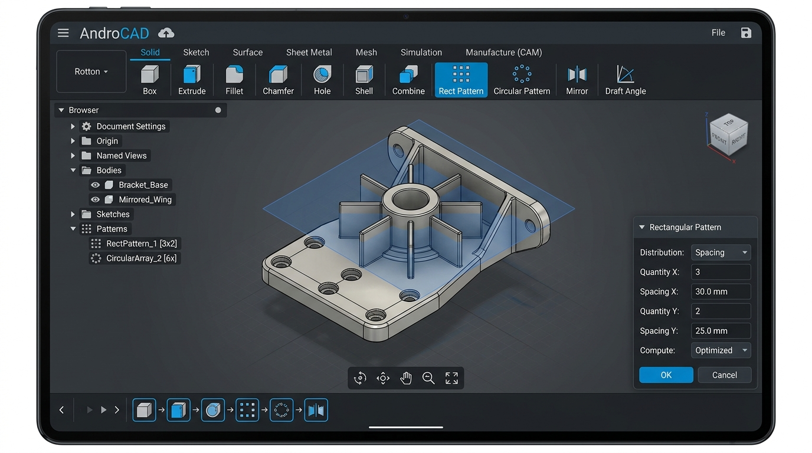
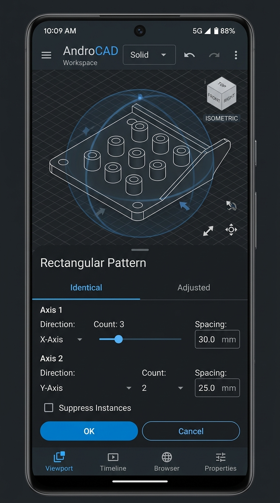

# Milestone 16 Report: Patterns, Symmetry & Feature Replicators

**Status:** Completed  
**Release:** `v0.16.0-beta`  
**Date:** 2026-10-21  

---

## 1. Executive Summary

Milestone 16 expands AndroCAD's solid modeling workspace with parametric feature and body replicators:
1. **2D Rectangular Pattern:** Linear grid array along two independent basis vectors ($U$ and $V$) with count and spacing controls.
2. **Polar Circular Pattern:** Rotational pattern array around arbitrary 3D datum axes with configurable angular range (up to 360°) and radial distribution.
3. **Planar Mirror Symmetry:** Exact reflection across datum coordinate planes (`gp_Trsf::SetMirror`) with optional body union fusion.
4. **Draft Angle Taper:** Face draft operation (`BRepOffsetAPI_DraftAngle`) applying mold release angles on vertical/selected faces for injection molding and casting design.
5. **Dual Device UX:** High-productivity workstation multi-pane UI on tablets and streamlined adaptive bottom-sheet drawer workflow on mobile smartphones.

---

## 2. Technical Implementation

### Core C++ Geometry Engine (`PatternEngine.h` & `PatternEngine.cpp`)
- **Linear Grid Transforms:** Computes $N_U \times N_V$ instances using translation vectors $\vec{T} = u \cdot s_U \hat{d}_U + v \cdot s_V \hat{d}_V$, transforming base shapes via `BRepBuilderAPI_Transform`.
- **Polar Array Transforms:** Computes rotational instances $\mathbf{R}(\theta_i, \mathbf{A})$ around `gp_Ax1` axis.
- **Mirroring:** Utilizes `gp_Trsf::SetMirror(gp_Ax2)` and builds manifold symmetric compound or fused solid via `BRepAlgoAPI_Fuse`.
- **Draft Angle:** Configures `BRepOffsetAPI_DraftAngle` with pull direction $\vec{P}$, neutral plane, and draft angle in radians.

### Host CTest Verification (`test_pattern_engine.cpp`)
All 5 automated unit and regression tests pass:
1. `TestRectangularPattern`: Validates 3x4 grid (12 instances), bounding box extent, and non-overlapping volume (12,000 mm³).
2. `TestCircularPattern`: Validates 6 polar pins around Z axis at radius 30mm with symmetric bounds.
3. `TestMirrorSymmetry`: Validates planar reflection across X=0 plane creating symmetric double volume.
4. `TestDraftAngleTaper`: Validates draft angle modification on prism faces.
5. `TestPatternFusedSolid`: Validates boolean fusion of overlapping pattern instances into a single contiguous manifold solid.

### JNI & Kotlin Integration
- JNI functions: `nativeRectangularPattern`, `nativeCircularPattern`, `nativeMirror`, `nativeApplyDraft`.
- Kotlin wrappers in `NativeKernel.kt` returning structured `PatternResultInfo` data contracts.
- Smart-cast safe integration in `MainActivity.kt` with immediate 3D rendering updates and timeline logging.

---

## 3. UI Screenshots

### Landscape Tablet Workstation UI

### Portrait Mobile Phone UI

