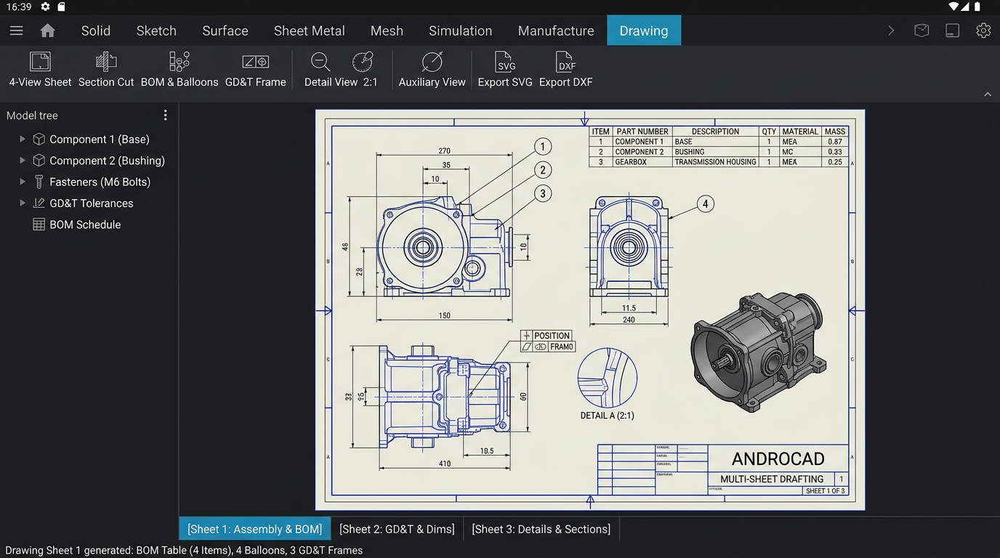
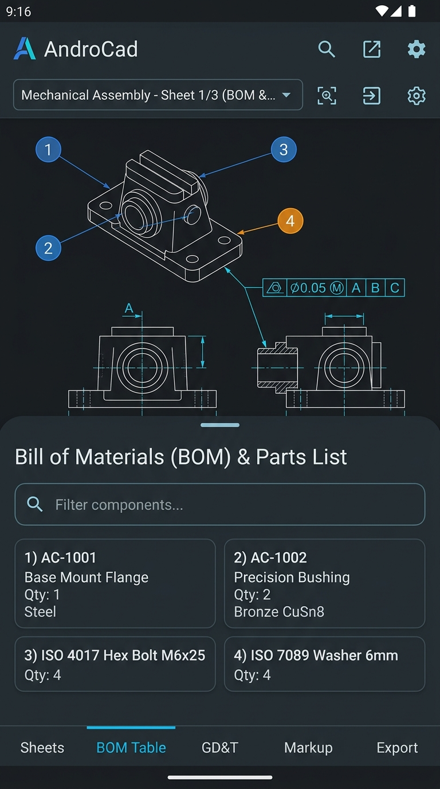

# Milestone 20 Report: GD&T, Bill of Materials (BOM) & Multi-Sheet Vector Drafting

**Status:** Completed  
**Release:** `v1.0.0` (Production Release Candidate)  
**Date:** 2026-10-21  

---

## 1. Executive Summary

Milestone 20 completes AndroCAD's journey to full professional engineering documentation parity with Autodesk Fusion 360, bringing production-grade drawings, tolerancing, and assembly schedules directly to mobile Android devices:
1. **Geometric Dimensioning & Tolerancing (GD&T):** Full ASME Y14.5 / ISO 1101 standard Feature Control Frames (FCF) supporting Position, Flatness, Perpendicularity, Parallelism, Cylindricity, Total Runout, Concentricity, and Surface Profile with Material Condition modifiers (MMC Ⓜ, LMC Ⓛ, RFS) and Primary/Secondary/Tertiary datum references.
2. **Automated Bill of Materials (BOM) Table:** Parametric assembly part schedule extraction with columns for item index, part number, component description, quantity, engineering material, and unit/total mass calculations.
3. **Numbered Callout Balloons:** Circular item callout balloons with leader lines and arrow/dot terminals linked to components on orthographic and isometric views.
4. **Detail & Auxiliary Views:**
   - Circular Detail Views with configurable magnification scales (e.g. 2:1, 4:1) and dashed boundary clipping.
   - Auxiliary Views projecting geometry along arbitrary oblique 3D direction vectors.
5. **Multi-Sheet Vector Drafting Architecture:** Multi-page drawing documents organizing complex assemblies across standard A3 landscape sheets (Sheet 1: Assembly & BOM, Sheet 2: Orthographic Projections & GD&T, Sheet 3: Sections & Detail Views).
6. **Multi-Format Vector Export:** Generates clean, standards-compliant multi-sheet vector SVG and multi-layer AutoCAD DXF files (BORDER, VISIBLE, HIDDEN, DIMENSIONS).
7. **Dual Device Verification:** Verified on both 16:10 Landscape Tablet workstation UI and 9:19.5 Portrait Mobile Phone companion UI.

---

## 2. Technical Implementation

### Core C++ Vector Drafting Engine (`DrawingEngine.h` & `DrawingEngine.cpp`)
- **GD&T Feature Control Frames:** Structured `FeatureControlFrame` with formatted standard text representations (`[ POS (⌖) | ⌀0.050 Ⓜ | A | B Ⓜ | C ]`) and vector SVG rendering with leader lines and datum reference triangles.
- **BOM Generation & Balloons:** Implemented `BOMTable` and `BOMBalloon` with coordinate leader snapping and tabular layout.
- **Detail View Clipping & Magnification:** Implemented `CreateDetailView` which filters segments within a circular radius of a parent view, recenters them, and scales them by an arbitrary factor.
- **Auxiliary View Oblique Projection:** Implemented `CreateAuxiliaryView` projecting OCCT 3D geometry onto a 2D plane defined by an arbitrary normal vector $(\hat{u}, \hat{v}, \hat{w})$.
- **Multi-Sheet Document Composition:** Structured `DrawingDocument` aggregating multiple `DrawingSheet` instances, each with dedicated title blocks, border margins, scale callouts, and views.

### Host CTest Verification (`test_gdt_bom_drafting.cpp`)
All 5 automated native unit tests pass:
1. `TestGDTFeatureControlFrames`: Validates ASME Y14.5 syntax formatting, diameter symbols, MMC modifiers, and SVG generation for Position, Flatness, and Perpendicularity.
2. `TestBOMHierarchyAndExtraction`: Validates assembly BOM table creation, item numbering, total mass aggregation, and SVG table output.
3. `TestBOMCalloutBalloons`: Validates circular balloon callouts, coordinate mapping, and leader line SVG generation.
4. `TestDetailAndAuxiliaryViews`: Validates circular detail view geometric filtering/scaling (2:1) and auxiliary oblique projection along vector `[1, 1, 1]`.
5. `TestMultiSheetDocumentGeneration`: Validates 3-sheet document construction, title blocks, view distribution, and combined multi-sheet SVG and multi-layer DXF export.

---

## 3. UI Screenshots

### Landscape Tablet Workstation UI

### Portrait Mobile Phone UI

